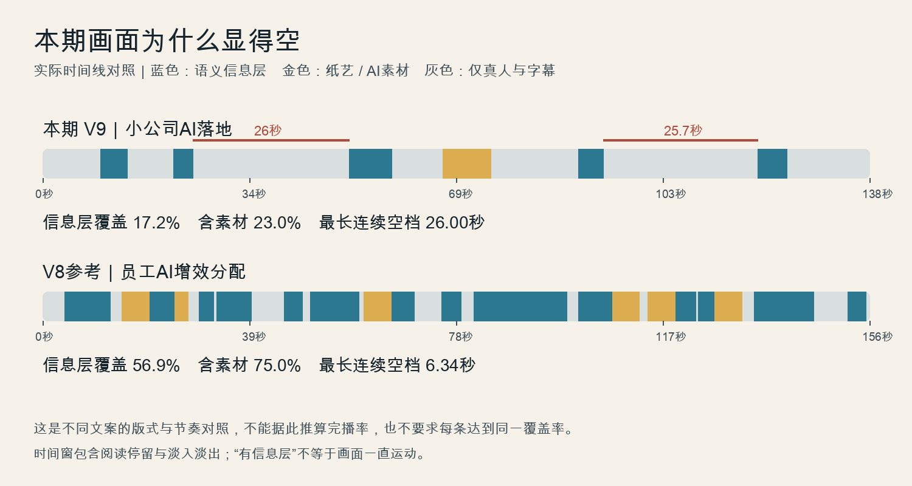

# 小公司AI这条为什么显得空｜V7、V8、V9实片对照

2026-10-17。本轮是当前成片的研究与诊断，不是新版本制作或整片验收。

结论：用户对“字号弱、排版空、长段只有真人”的反馈有实片依据。本次编排过于保守，未把旧片已经具备的关系表达和持续承接充分用起来。现有V9技术参数确实被消费，但版本号本身没有保证每条的导演质量。

## 实际差距

| 指标 | 本期《小公司AI落地》 | V8参考《员工AI增效分配》R2 |
| --- | ---: | ---: |
| 视频时长 | 137.53秒 | 155.63秒 |
| 语义信息层数量 | 5组 | 19组 |
| 信息层时间窗并集 | 23.70秒／17.2% | 88.59秒／56.9% |
| 加入纸艺／AI素材后 | 31.70秒／23.0% | 116.75秒／75.0% |
| 最长连续无信息层／插片 | 26.00秒 | 6.34秒 |

统计按被组件消费的名义时间窗求并集，包含淡入淡出和阅读停留，不代表动画始终在动。账号角标、常规字幕、人物自然手势和数字运镜不计作信息层。两片文案、表演、素材量不同，这不是留存实验，不能照搬75%的占比。

当前信息窗口：9.67—14.10秒两个问题；21.80—25.00秒关键词；51.00—58.10秒六岗位；66.60—74.60秒纸艺；89.13—93.30秒真实业务问题；119.00—123.80秒行业提示。

当前最值得返工的空档：**25—51秒（26秒）和93.3—119秒（25.7秒）**。前者恰好在讲大企业层级与小公司拍板的对照，后者在讲价值、焦虑、工具闲置与业务匹配，都有可以看见的关系。7段数字运镜确实存在，合计60.9秒，但1.05—1.06倍轻推近无法代替这些信息表达。

## 字小和排版空的具体原因

- 当前主字60px、辅助字44px、账号角标24px。以1920横屏完整缩至390px宽为例，分别约12.2、8.9、4.9px。这是显示比例演算，尚不是手机实测；更不能把“1080p”当作手机可读保证。
- 信息区固定580×340，只占画面9.51%；六岗位实际约580×180，占全画面5.03%。几个短词排在固定宽浅卡里，卡片余白多，视觉重心较弱。
- 实际12.5、55、90秒帧未发现文字互相遮挡或裁断。问题主要是比例、主次、留白、内容布局重复；不能把审美反馈误写成已经发现溢出故障。
- 浅卡中的深色文字继承较重的黑色阴影，边缘显脏。字号增大时应同步减弱这层阴影，不能只把整个卡片一起放大。
- 五组大多是7—12帧短入场后停住的标签。缺少层级、对照、分支等不同关系布局；内容说完一部分后画面随即撤掉，下一段也没有接住。

建议试排值（不是已验收标准）：短主词76—88px；辅助节点52—60px；对需要更大字的短主词再逐帧看能否到96px。长词分两行，按语义断行；卡片随内容收紧。账号角标可试30—32px，但主要空间要交给本段信息。依人物脸、手势的真实位置选左上、侧栏或顶部关系图，安全时参考现有660×414区域，不统一搬成900px宽大板。

## V7、V8实际该借哪些东西

已抽取并查看两个实际MP4及代表性连续状态，另核对锁定哈希；本轮没有冒充正常速度全片视听。

1. **V7.2《真正能穿越周期的两类资产》**：12秒三项并列；205秒两类资产对照；263秒两路汇聚；291秒四步流程。优点是用不同构图表达不同关系，让信息持续承接。它的900px对照区、870px流程区依赖当期人物明显靠右，本期不能整块照搬。12秒主标题末尾“么？”孤行、部分22—28px小字也不应复刻。
2. **V8《员工AI增效分配》R2**：7.8秒正反对照；37秒两种状态；81.2—92.36秒围绕同一标题逐步出现中心和两个分支；137.5—145.2秒结论流程。尤其85.53、88.33秒两次分支展开，是内容推进带动画面推进，而非每句话重新弹卡。
3. **字号不回退**：V8这套实际还受`scale(0.8)`影响，主字约48px、辅助约35.2px，低于本期60/44。旧片值得继承的是关系组织、空间利用、阅读停留和节奏；字号仍应根据本条重新做大。

[V7实片联系表](reference_frames/v72_contact.jpg) · [V8实片联系表](reference_frames/v8_contact.jpg) · [V8连续分支展开](reference_frames/v8_relation_progress.jpg) · [本期16帧联系表](本期16帧联系表.jpg)

历史实片：

- `outputs/真正能穿越周期的两类资产_16x9_V72_有音效_正式成片_v2.mp4`
- `edit/20260917_ai_efficiency_sharing/08_正式成片/员工AI增效分配_R2_V8_1080P_正式候选_v1.mp4`
- 活动档案绑定的是同套V8工程43.8秒观看版，SHA为919914918e1633f3083c49f887bc1fc524f8e2b760cda374f50b33920a0c52c7；完整候选只是本轮全片节奏参考，不因此升级为用户已验收正式片。

## 本条建议怎样改

以下是本期实录锚点对应的画面功能建议，不是重写口播、最终文字版式或已批准的时间线。

| 实录位置 | 画面功能建议 | 需要解决的问题 |
| --- | --- | --- |
| 1.13—4.80秒“十来个人规模” | 用人数概念建立视觉锚点；到9.67秒问题出现时承接原对象 | 开场不等到第10秒才出现第一次信息辅助 |
| 9.67—25.00秒“两问／组织灵敏性” | 问题分主次呈现，核心词加大，口播转入解释时保留认知锚点 | 避免几个同宽浅色标签一闪而过 |
| 24.20—36.53秒“大企业层级多…需要很久” | 随实际词出现，逐层显示汇报、会议、协调关系，保留完整结构到句尾 | 补上26秒长空档的前半段 |
| 36.53—46.97秒“小公司…拍板…当天定方向” | 从前一结构自然转入小组织的决策关系，以简明对照收束 | 用画面解释差异，避免只用推近表达所有重点 |
| 47.27—58.17秒“不需要全员…核心岗位” | 清楚表达否定范围，再逐项显出岗位，最后停留完整集合 | 字更大；不能把“不需要”做成正向流程；不虚构岗位间先后 |
| 66.60—74.60秒纸艺 | 沿用本次素材及左下真人交接 | 已有动作解释，不为提高数量另叠花字 |
| 79.07—87.73秒“交付周期长…交付快” | 配对的维度对照，随实际说到的词改变焦点 | 补上这段只有口述的对比；不画无依据的倍速或业绩条 |
| 89.13—96.87秒“真实业务问题…企业／老板／团队” | 以业务问题为共同中心，分支按语义出现并读稳 | 让下一句接住上一句，减少刚出现又撤掉 |
| 98.67—118.80秒“焦虑／工具闲置／匹配业务” | 工具累积与业务落点之间的关系逐步明确；讲到不同卡点时只切当前焦点 | 补第二个近26秒空档；保留本人情绪与手势，不全程盖满 |
| 119.00—124.07秒“留下行业” | 加大最后的参与入口，给读完时间；后续面对面邀请与身份句回到本人 | 行动引导不再是一枚小小的角落标签 |

这些自然单元大约对应10组左右的连续信息段，但数量是分析结果，不是必须凑满的配额。数字运镜在论点、反转和结论处配合主次，不和每个字卡同时晃动；镜头切换、字的出现、关系展开、重点高亮都可以提供有效变化。

**最小下一步建议：先取24.20—46.97秒约23秒，用“大企业层级→小公司拍板”的同一段原声做现版与新版对照。** 这一段能同时检验大字、版式、连续关系和节奏；通过后再将同类做法应用到本片其他段落。没有必要重做纸艺、寻找新插件或先重渲染137秒整片。

验看要点：按实际手机播放尺寸能否一眼读清；画面是否在词义发生时变化；关键结构能否读完；不盖脸、手势或字幕；关系是否准确；正常速度下是否比现版更容易理解。以真实观看反馈判断，不以新增卡片数或测试数量判断。若字更大却更遮挡、变化增多却更难读，应先减字/拆行/延长结果停留。

## 更频繁出现，是否就更不容易被划走

增加与口播同步的视觉提示，有依据支持。28名化学专业学生的眼动实验发现，动态提示能帮助注意相关信息、改善记忆并降低额外认知负担；但对象是教学视频，不是抖音短视频，不能据此许诺本账号完播率提升。[原始研究：Rodemer等，2022](https://onlinelibrary.wiley.com/doi/full/10.1002/acp.3973)

另一项MOOC观看研究支持连续视觉展开，也发现自然、有交流感的真人镜头有价值，并把“何时、多久切一次”列为未解决的问题。它不能证明快速剪切越多越好。[作者公开原始论文：Guo等，2014](https://pg.ucsd.edu/publications/edX-MOOC-video-production-and-engagement_LAS-2014.pdf)

因此，本次建议提升**与语义一致的可见变化和信息覆盖**，保留表达有价值的真人段落。还没有本条发布后逐秒留存数据，不给出“每3秒一切”“一定降低划走”等结论；也不将旧V7的固定秒数经验自动恢复为当前强制规则。

## 执行差距与证据

本期扫描了27个真人段、157张Shotcraft卡与214样式；两个机器候选因否定关系、阅读时间和超出空间弃用，理由成立。执行差距在于弃用后沿用原五组，没有重新处理整片长空档。匹配请求中已经识别出层级、拍板、工具闲置等机会，最终没有转成可见关系。后续应分别记为“不适合”和“适合但未实现”，不能用“已扫描”替代落片。

- 本期时间线：`edit/20261017_small_business_ai_agility/05_剪辑工程/runtime-plan.v1.json`，813行起信息层，914行起纸艺，942行起运镜。
- 本期实现：`remotion/src/small-business-ai-agility-20261017/Composition.tsx`，75行起字卡、131行信息层阴影，229行账号角标；`runtime.ts:11`区域。
- 候选比较：`edit/20261017_small_business_ai_agility/05_剪辑工程/动效匹配/候选比较与本期采用边界.md`、`候选复核事实.v1.json`、`auto-match-request.v1.json`。
- V7实际入口：`remotion/src/CycleAssetsV72Talk16x9.tsx`；V8实际运行计划与组件：`remotion/src/employee-ai-efficiency-v8-r2/runtime-plan.v2.json`、`V8SemanticStage.r2.tsx`。
- 规则读取与应用：`knowledge/16`只作历史参考；`knowledge/17`核对运镜教训；`knowledge/20`核对透明信息、连续关系与音效；`knowledge/23`确认当前V9继承而非降级；导演Skill只用于语义判断，不重新启动生成链。
- [本次计算结果与输入哈希](覆盖率与长空档.v1.json)。本期原片、字幕、纸艺、生产代码、活动档案和授权均未修改；本轮只产出研究材料。
